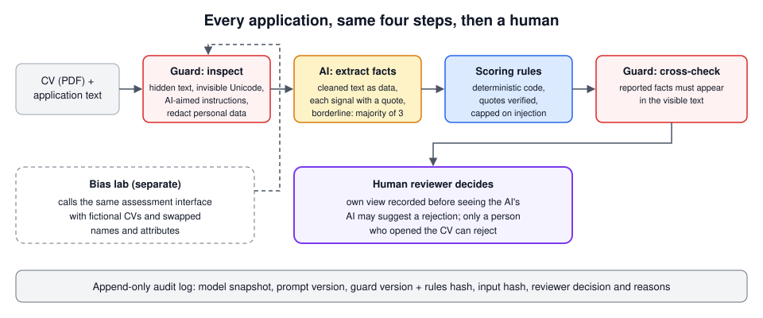

# BioRecruit

An applicant-screening system for small, fast-hiring teams, built so that the AI helps read applications and a
human makes every decision.

Built for a venture-backed biotech startup. The product code is private; this repository describes the problem,
the architecture and the fairness and reliability work.

## The problem

A small startup that posts a role can receive hundreds of applications. Reading every CV properly takes hours a
founder does not have, so screening gets rushed or keyword-based, and good candidates with unusual paths are lost.
Handing the job to an AI creates new problems: CVs can contain hidden instructions aimed at the AI, models can be
inconsistent and biased, candidates' personal data is sensitive, and under the EU AI Act, AI used to filter or
evaluate job applicants is classified as high-risk.

## Who it is for

Early-stage teams hiring a handful of people from many applications, who want help reading, not an automatic
reject button.

## What it does

1. Checks every CV and application text for hidden or manipulative content, and removes personal details the
   assessment does not need, **before** any AI sees it.
2. Uses an AI to extract facts from the cleaned text, with a quoted piece of evidence for each.
3. Computes scores and tiers with deterministic rules in code, not inside the AI.
4. Checks the AI's answer against the CV's visible text.
5. Puts every candidate in front of a human reviewer, who records their own view and decides. The AI can suggest
   a rejection; only a person who opened the CV can reject.

## Architecture

Three separate components:

- **The app**: the review interface, case storage, audit log and the assessment pipeline.
- **The guard**: a separate, deterministic program with no AI in it. It never imports the app's code; the app only
  sends it input and reads its verdict.
- **The bias lab**: a separate black-box tester that only calls the same assessment interface the app uses, and
  never reads the app's code.

Each client runs in its own isolated backend project. Client builds require sign-in with a second factor; local
and demo modes run on one machine with a fictional company and fictional candidates.

## Hard technical problems, and how they were approached

1. **Hidden instructions in CVs.** A PDF can carry white text, 1-point text, text outside the page, text under an
   image, switched-off layers, invisible Unicode, or plain "ignore previous instructions" in five languages. The
   guard detects these, keeps hidden text away from the AI, and records what it found. After the AI answers, every
   institution, employer and title it reported must appear in the **visible** text.
2. **An AI that is not consistent with itself.** The AI only extracts facts and yes/no signals, each with a quote
   that code verifies against the text. The scoring is done in code, and borderline signals are decided by a
   majority of three answers.
3. **Bias you cannot see in one CV.** Bias is measured, not assumed absent: the same fictional CVs are scored with
   swapped names, pronouns and added protected attributes, and compared against each CV's own noise. Runs found
   real problems, which were fixed and re-tested (below).
4. **Keeping the human in charge.** Reviewers see candidates in arrival order, record their own view before seeing
   the AI's, and write reasons in their own words. Every decision is logged with who, what they saw and whether
   they opened the CV.
5. **Personal data.** Names, contact details and protected attributes are removed before the AI. Each client's
   data stays in its own project. Candidates are deleted automatically when their retention period ends.

Deeper pages: [docs/01_architecture_and_safety.md](docs/01_architecture_and_safety.md),
[docs/02_fairness_testing.md](docs/02_fairness_testing.md),
[docs/03_privacy_and_compliance.md](docs/03_privacy_and_compliance.md).

## Results

All on fictional CVs and a fictional company. No real candidate data was used for testing.

| Test | n | Result |
|---|---|---|
| Guard test suite (attack and normal fixtures) | 33 tests | 33 pass |
| Prompt-injection outcome test | 24 attacks | 0 of 24 raised a candidate's tier; fake credentials never reached the AI |
| Gender, origin and attribute screening (full run, 13 Oct 2026) | 459 assessments, 9 CVs + 1 control | No group difference beyond noise; gender gap +1.1 points over 126 pairs; impact ratios 0.88 to 1.00 |
| Career-gap control (same CV with and without a gap) | same run | −0.3 points (95% CI −0.5 to 0.0) |
| Language effect: non-native vs fluent English version of one CV | 102 assessments | −5.2 points (95% CI −7.1 to −3.4). **Found, then reduced** |
| Language effect after the fix (full run) | 510 assessments | −1.8 points (95% CI −2.6 to −1.0). **Still present** |

Method and limits: [docs/02_fairness_testing.md](docs/02_fairness_testing.md). This is screening with few repeats,
not proof that no bias exists. The latest full re-run after the last scoring change was cut short (74 of 510
assessments), so the current version is not yet fully re-tested.

## Status

Local and demo modes work end to end. The client deployment path (pipeline running inside each client's own backend
project) is built but not yet verified in a live deployment. Not yet shown to meet the EU AI Act's high-risk obligations,
which apply from December 2027; the gap list is tracked.

## Roadmap

- Complete the full bias re-run on the current version.
- Define accuracy metrics, for example human and AI agreement per release.
- Close the remaining EU AI Act items: conformity assessment, declaration, registration.

## What this repository is not

No source code, prompts, scoring rules or weights, configuration, schemas, client information or real candidate
data.

## Contact

Yasmyna Feraru (Nina) · yasmyna.feraru(at)officialtetelestai.com · GitHub [@yasferaru](https://github.com/yasferaru)
