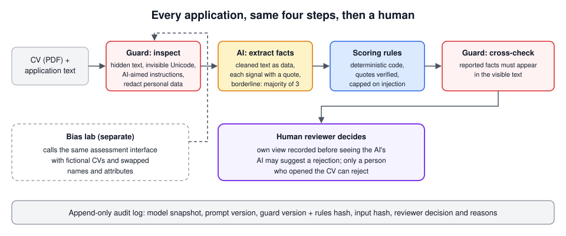

# 1. Architecture and safety



## 1.1 One pipeline, two places

Every application goes through the same four steps, in the same order:

```
guard (inspect) -> AI (extract facts) -> scoring rules (code) -> guard (cross-check)
```

In local and demo modes, a local server on the user's machine runs it. In client builds, it runs inside the
client's own backend project, where the AI key is a secret of that project and never part of the app, and callers
must be signed in with a second factor and stay within rate limits. This client path is built but has not yet been
verified in a live deployment.

## 1.2 The guard, before the AI

A separate deterministic program, with no AI in it. It checks:

- **Hidden text in PDFs**: white or background-coloured text (a designed CV with white text on a dark sidebar is
  recognised as normal), very small text, invisible render mode, text placed off the page, text covered by an
  opaque shape, text in switched-off layers. Instructions in PDF metadata are reported too.
- **Invisible Unicode**: zero-width characters and direction controls are removed. Unicode "tag" characters, which
  can carry a hidden message, are decoded so the reviewer can read what was hidden.
- **Instructions aimed at an AI**, in several languages, after folding look-alike letters from other alphabets:
  attempts to override instructions, role markers, attempts to break out of the data section, requests for a
  score or for the prompt.
- **Redaction**: contact details, the candidate's name (including inside profile links), and protected
  attributes such as age, family status, nationality, gender, religion, health and photo lines. Dates of jobs and
  degrees and the languages spoken are kept, because they matter for the job.

Verdict: clean, review or suspicious. Every result carries the guard's version and a hash of its rule files, so
each assessment can be traced to the exact rules that ran. The guard listens only on the local machine, accepts
no calls from web pages, and never logs CV content.

## 1.3 The AI, constrained

- It receives only the cleaned text, marked as data.
- It returns facts and yes/no signals in a strict structure, each signal with a quote.
- Code checks every quote against the text. Key terms outside real sentences are ignored. If the text tries to
  instruct the AI, the score is capped.
- Borderline signals are decided by a majority of three answers, at zero temperature.
- The AI is told not to infer age, gender, origin, health or family, and the bias lab checks whether it does.

## 1.4 Scoring in code

Scores and tiers are computed by deterministic rules from the extracted facts, with an explanation per rule. The
rules and weights are not published. Because the rules are code, a change to them is versioned and the bias lab
can be re-run against it.

## 1.5 The guard, after the AI

Every institution, employer, job title and field the AI reported must appear in the CV's visible text. A fact found
only in hidden text is a high-severity mismatch. A high score from very little text, or for an application the
guard already found suspicious, is flagged for the reviewer.

## 1.6 The human decides

- Candidates are reviewed in arrival order, in one queue.
- The reviewer records their own view **before** seeing the AI's.
- Reasons are written in the reviewer's own words.
- The AI can at most suggest a rejection. A rejection needs a person who opened the CV.
- Every decision is logged: reviewer, their own view, decision, reasons, time, and whether the CV was opened.
- Every assessment is logged too: model snapshot, prompt version, guard version and rules hash, input hash, tier.
